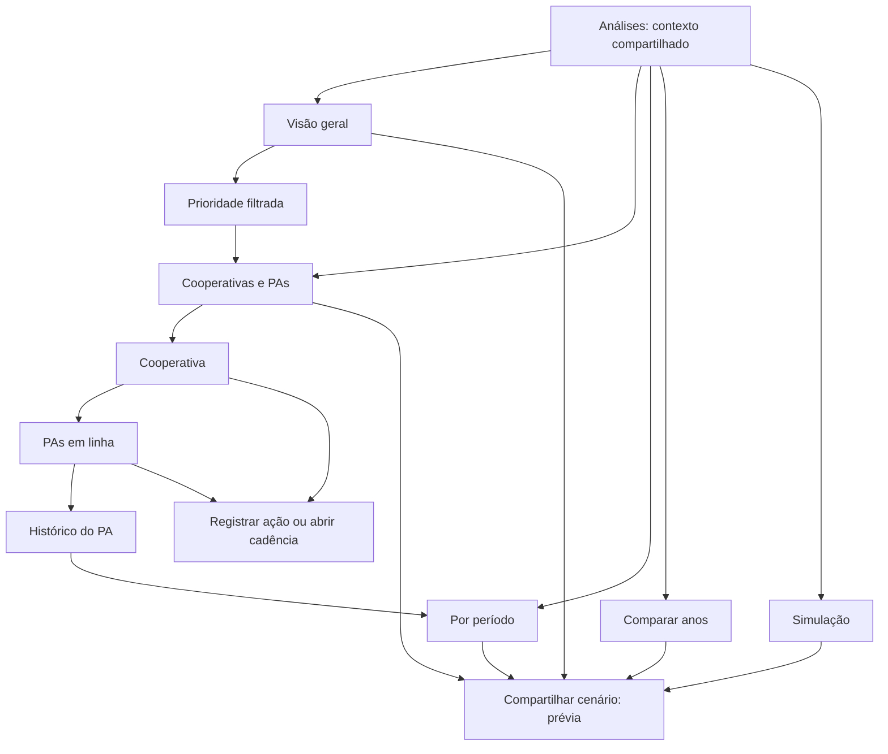

# Análises comerciais: navegação e critérios de apresentação

Revisão de 16/10/2026 a partir do PDF de seis páginas `GESTAÃO E FLUXO(1).pdf`. A fonte de dados, permissões, isolamento por conta, cadastro anual, importações e regras financeiras permanecem no motor existente. Os valores do PDF são referências de validação, nunca constantes da interface.

## Mapa final

O menu lateral mantém Análises, Cadência dos PAs, Plano de ação, Agenda e Metas atingidas. Conferência da base, Importações e Cadastro e metas ficam em Administração.

## Organização por tela

| Tela | Conteúdo principal | Próximo passo |
| --- | --- | --- |
| Visão geral | Contexto, quatro indicadores, até três prioridades, resumo de até cinco unidades na tela e acessos às outras análises | Abrir a prioridade ou analisar a unidade |
| Cooperativas e PAs | Todas as unidades filtradas em sete colunas; seleção e ordenação; indicadores complementares opcionais | Analisar cooperativa, expandir PAs, abrir histórico ou registrar ação |
| Por período | Tabela ou gráfico; indicador selecionável; mensal, trimestral, semestral ou anual; todos os 12 meses | Comparar a evolução ou compartilhar os períodos |
| Comparar anos | Anos e meses fechados equivalentes, cortes por ano, variação absoluta, percentual e composição da base | Conferir unidades e compartilhar o comparativo validado |
| Simulação | Realizado, projeção sem aumento, cenário com premissas, impacto, GAP projetado e esforço do mesmo período | Restaurar premissas ou compartilhar a estimativa identificada |

Ano, carteira, central, tipo de período e período ficam visíveis em uma barra compacta. Corte e estado da base aparecem no resumo. Fonte, cooperativa, PA, grupo, situação, agrupamento e busca ficam nos filtros complementares. O contexto compatível permanece ao mudar de aba. Cada carteira conserva os próprios valores e cortes quando VN e AR são exibidas juntas.

## Retorno e identidade das unidades

A trilha Análises / Central / Cooperativa / PA apresenta apenas os níveis aplicáveis. Nomes são lidos do cadastro, com código de fallback para referências órfãs. O snapshot de retorno inclui aba, fonte, carteira, unidade, período, busca, situação, ordenação, expansão dos PAs, seleção, prioridade e posição da página. Voltar do histórico preserva o ponto de trabalho da lista.

Analisar cooperativa abre o recorte da unidade; Ver PAs expande a lista imediatamente abaixo; Ver histórico abre a evolução do PA; Abrir cadência mantém sua central e cooperativa e usa Venda Nova, conforme a fonte validada. Registrar ação abre o editor contextualizado existente.

## Indicadores e coerência

- Atingimento consolidado: soma do realizado dividida pela soma das metas do mesmo período. Não é média dos percentuais individuais.
- GAP consolidado: falta líquida para a meta da seleção, compensando superações.
- Déficits das unidades: faltas individuais sem compensação. A concentração usa esse denominador e leva à lista correspondente.
- Projeção: estimativa do horizonte identificado. O GAP projetado usa a mesma meta e horizonte.
- Ritmo: comparação com referência proporcional até o corte, separada do percentual final da meta.
- Não existe modelo validado de probabilidade de fechamento; a interface não inventa probabilidades.
- Esforço consolidado: GAP consolidado / prazo restante, apenas quando cortes e prazos são comparáveis. Os esforços individuais continuam disponíveis nos detalhes. Dias úteis consideram segunda a sexta, sem descontar feriados.

A referência do PDF concilia R$ 577.560,00 de meta, R$ 515.331,67 de realizado (89,2%), R$ 62.228,33 de GAP consolidado, R$ 549.383,08 de projeção (95,1%) e R$ 28.176,92 de GAP projetado. Os R$ 70.936,13 de déficits individuais incluem R$ 8.707,80 compensados por superações no consolidado. A auditoria detalhada está em `UX_ANALISE_CALCULOS.md`.

## Correções de apresentação e consistência

1. O esforço diário exibido junto do GAP consolidado no PDF usava a soma dos déficits individuais. A nova apresentação deriva o esforço consolidado somente com prazo equivalente; não altera o esforço de cada unidade.
2. A simulação preserva a coorte escolhida antes de aumentar o ritmo. Uma unidade que passa de Atenção a Em rota pela projeção continua na mesma comparação; metas e realizado não desaparecem ao mover a premissa.
3. O retorno da análise e do histórico restaura a seleção compatível e a fonte correta, sem confundir produção da cooperativa com produção dos PAs.
4. Ausência de dado, meta ausente, meta zero e resultado zero permanecem estados distintos; nenhuma célula é preenchida artificialmente com zero.
5. Exportações comparativas identificam os meses realmente comparados e os cortes dos dois anos, evitando que o rótulo Anual sugira um ano completo quando só há meses fechados comuns.

## Compartilhamento e impressão

Compartilhar cenário parte da análise ativa e oferece resumo, cooperativas, PAs, períodos, comparativo e simulação. A prévia e a saída usam a mesma coorte completa, inclusive registros fora da área visível. HTML e texto preservam a lista completa. Imagens extensas podem ser divididas por unidades para manter legibilidade; o compartilhamento dos 19 períodos permanece em uma única imagem, incluindo dezembro. Simulações levam a premissa no cabeçalho de todas as saídas.

A impressão usa A4 paisagem, cabeçalhos de tabela repetidos, valores monetários sem quebra, nomes completos e registros sem corte entre páginas. Os painéis podem continuar na página seguinte, evitando páginas quase vazias. Navegação, controles e o link Ir para o conteúdo são ocultados somente na impressão. O link mantém foco e funcionamento por teclado na tela. A Visão geral renderiza as unidades adicionais para impressão, mesmo que o resumo da tela mostre apenas cinco.

## Validação

Testes unitários verificam a referência do PDF, esforço com mesmo prazo, ausência de base, metas divergentes, hierarquia e simulação com coorte estável. Jornadas de navegador verificam contexto entre abas, central/cooperativa/PA, retorno com seleção e posição, prioridades, histórico, compartilhamento, simulação e impressão. A base usada nos testes e nas capturas é sintética; não substitui nem altera os dados operacionais.
